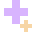
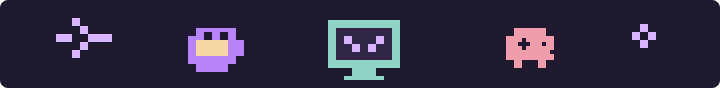
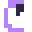
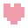
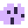
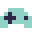
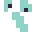
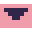

<h1 align="center">Olá, eu sou a Larissa!  </h1>

  <i>Transformando café, curiosidade e código em experiências criativas.</i>

  

  

---

##  Sobre mim

-  Desenvolvedora em construção, apaixonada por tecnologia e criatividade.
-  Sempre aprendendo algo novo e transformando ideias em projetos.
-  Gosto de unir uma estética divertida com soluções funcionais.
-  Meu espaço no GitHub é onde compartilho minha evolução no mundo dev.

##  Tecnologias que estou explorando

  
  &nbsp;&nbsp;
  
  &nbsp;&nbsp;
  
  &nbsp;&nbsp;
  
  &nbsp;&nbsp;
  
  &nbsp;&nbsp;
  

##  Vamos conversar?

  
  

  

